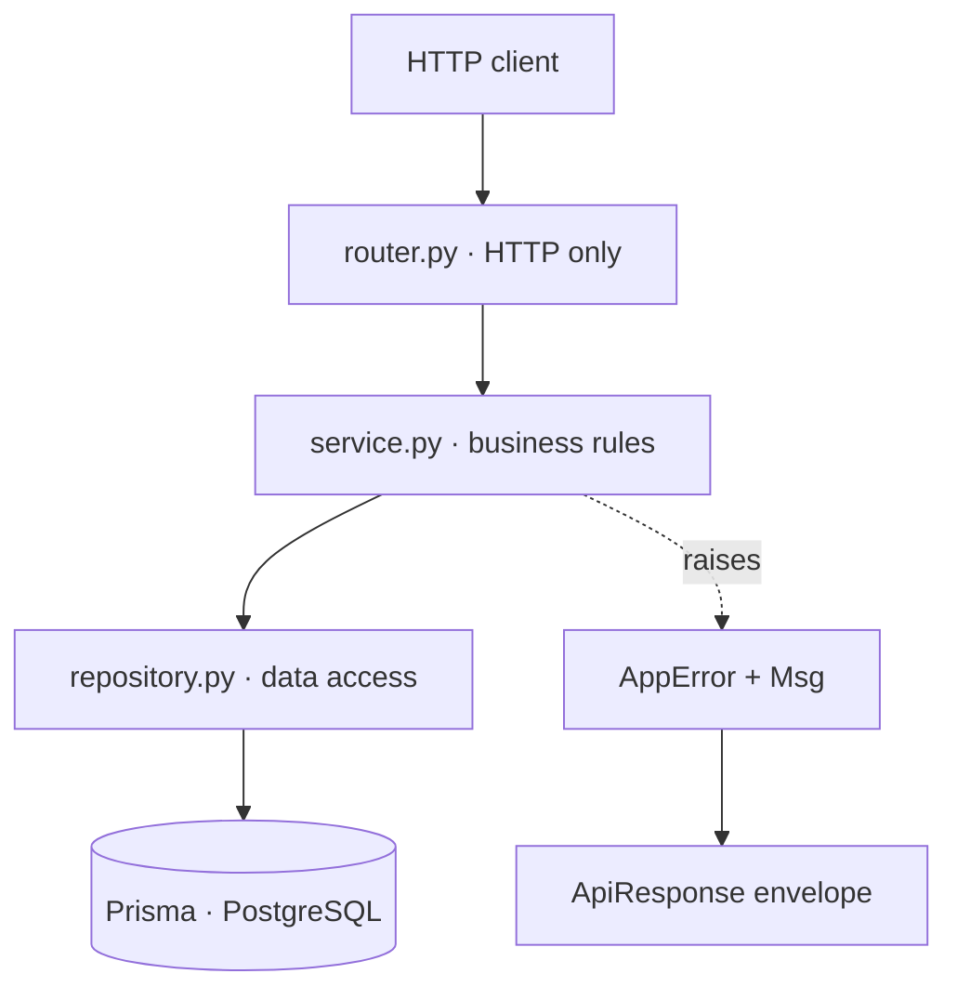
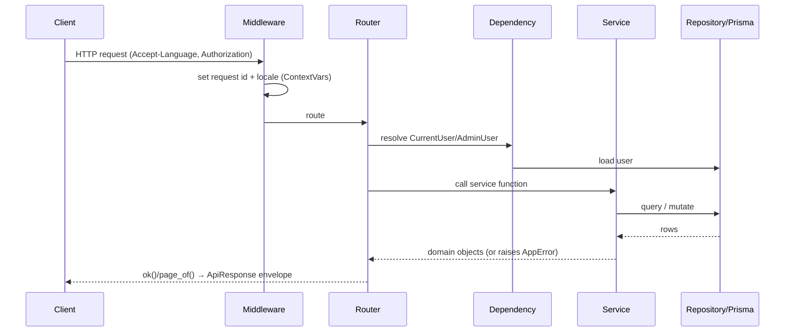

# 02 — Architecture

> The layers, the allowed imports, the request lifecycle, and where code goes.

## What you will learn
- The four layers and what each may do.
- Which imports are allowed and forbidden.
- The lifecycle of a request and of an error.
- A decision table for "where does this code go?".

## The layers
Every feature is built from the same four layers. Data flows downward; nothing flows upward.

- **Router** — HTTP concerns only: path, method, status code, `response_model`, `summary`,
  `description`. Delegates to the service. Contains zero business logic.
- **Service** — business rules. Module-level async functions. Raises `AppError` subclasses with
  `Msg` keys. Never touches `Request`/`Response`.
- **Repository** — data access only. Subclasses `BaseRepository`; adds feature-specific queries.
- **Prisma** — the generated async client and PostgreSQL.

## Allowed and forbidden imports
| From | May import | Must NOT import |
|---|---|---|
| router | service, `deps`, shared helpers, `core` | repository directly, another feature's router |
| service | repository, `core`, shared helpers, another feature's service/repository/deps/schemas | any router, `Request`/`Response` |
| repository | `core.database`, `BaseRepository` | service, router |
| any feature | another feature's `service`/`repository`/`deps` | another feature's `router` |

## Request lifecycle

## Error flow
Any `AppError` raised in a service is caught by the handler registered in
`app/core/exceptions.py` and rendered as the same `ApiResponse` envelope with `success=false`, a
stable `code`, and a localized `message`. `RequestValidationError` becomes a `422` with per-field
details. Unexpected exceptions become a `500` and are logged with the request id. Features never
raise `HTTPException` and never build the envelope by hand.

## Where does this code go?
| I need to… | Put it in |
|---|---|
| Add a new resource | a new folder `app/features/<x>/` (copy `notes`) |
| Add a route to an existing feature | that feature's `router.py` + `service.py` |
| Read an env var | `app/core/config.py` (+ `.env.example`) |
| Add a constant/enum | `app/core/constants.py` |
| Add user-facing text | `Msg` in `app/core/messages.py` + every locale JSON |
| Share logic between features | `app/shared/helpers/` or `app/shared/utils/` |
| Expose a tool to agents | the feature's `tools.py` with `@mcp_tool` |

## Slow work, audit, cache
- **Slow work** (> ~1s, external I/O, fan-out) is a **job**: the router returns `202` with
  poll headers and a handler in `features/<x>/jobs.py` runs on the worker (see chapter 13).
- **Mutations** call `audit.record(...)` in the service (chapter 14).
- **Hot reads** use `@cached` with invalidation on every write path (chapter 15).
- Infrastructure (`core/jobs`, `core/audit`, `core/activity`, `core/cache`) owns its own
  repositories; `core/` never imports `features/`.

## Common mistakes
- Business logic in the router.
- A feature importing another feature's router.
- Duplicating a helper instead of searching `app/shared/` first.

## See also
- [03 — Project structure](03-project-structure.md)
- [04 — Conventions](04-conventions.md)
- [12 — Feature lifecycle](12-feature-lifecycle.md)