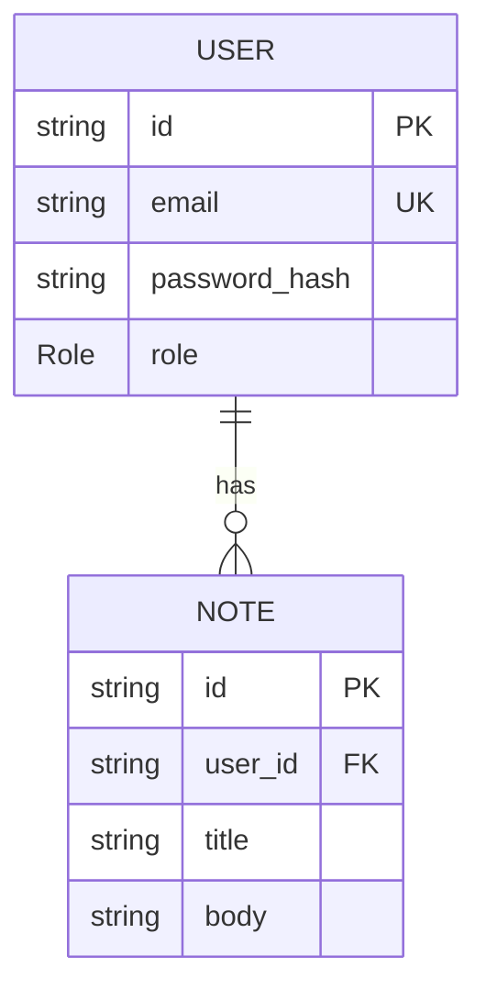

# 07 — Database

> The Prisma schema, the repository contract, and the migration workflow.

## What you will learn
- The data model and how it maps to tables.
- How repositories wrap the Prisma client.
- How migrations work (and the one rule: never edit an old migration).
- JSON, transaction, and pitfall notes.

## The schema
`prisma/schema.prisma` uses the `prisma-client-py` generator in `asyncio` mode against PostgreSQL.

- **`User`** (`@@map("users")`): identity, `password_hash`, `role`, `locale`, `is_active`,
  timestamps, and a one-to-many `notes` relation.
- **`Note`** (`@@map("notes")`): `user_id` FK with `onDelete: Cascade`, `title`, `body`,
  timestamps, indexed on `(user_id, created_at)`.



## The Prisma client
`app/core/database.py` exposes a single `db = Prisma(auto_register=True)` plus `connect_db` /
`disconnect_db`, invoked by the app lifespan. Access models as `db.user`, `db.note`. Generated
models are imported from `prisma.models` (e.g. `from prisma.models import User`).

## The BaseRepository contract
`app/shared/helpers/repository.py` provides generic `get`, `create`, `update`, `delete`, and
`paginate` over any delegate. Feature repositories subclass it and add only their own queries:

```python
class NotesRepository(BaseRepository[Note]):
    async def list_for_user(self, user_id, params):
        return await self.paginate(params, where={"user_id": user_id})
```

This thin layer is the **escape hatch**: to swap Prisma for another data layer, reimplement the
repositories without touching services or routers (see ADR 0003).

## Migration workflow
1. Edit `prisma/schema.prisma`.
2. `make migrate` (`prisma migrate dev`) — creates a new migration and applies it.
3. **Never edit an existing migration file.** Migrations are an append-only history.
4. Destructive changes (drop/rename column) require an ADR first (see the update-feature playbook).

In production, `make deploy-db` (`prisma migrate deploy`) applies pending migrations.

## JSON, transactions, pitfalls
- For multi-step writes that must be atomic, use `db.tx()` for a transaction.
- JSON columns are fine for genuinely free-form data, but prefer explicit columns for anything
  you query or index.
- N+1 queries: use Prisma's relation loading (`include`/`select`) instead of looping.
- The test suite is **DB-free**; do not require a database to run `make test`.

## Jobs, audit and activity tables
- `Job` (`jobs`): the queue. Claimed with raw `UPDATE ... FOR UPDATE SKIP LOCKED`. **Raw SQL does
  not run Prisma's `@updatedAt`, so set `updated_at = now()` yourself**, and cast enums
  (`'RUNNING'::"JobStatus"`).
- `AuditLog` (`audit_logs`): append-only. A DB trigger blocks `UPDATE`; only `INSERT` and the
  retention `DELETE` are allowed. No FK to `users`.
- `ActivityLog` (`activity_logs`): high-volume request log, no FK to `users`. `path` is the route
  template, never the raw URL.

## Common mistakes
- Editing an old migration instead of creating a new one.
- Dropping a column without an ADR.
- Putting queries in the service or router instead of the repository.

## See also
- [Playbook: add a model and migration](playbooks/add-model-and-migration.md)
- [08 — Authentication](08-authentication.md)
- [ADR 0003](decisions/0003-prisma-client-python.md)