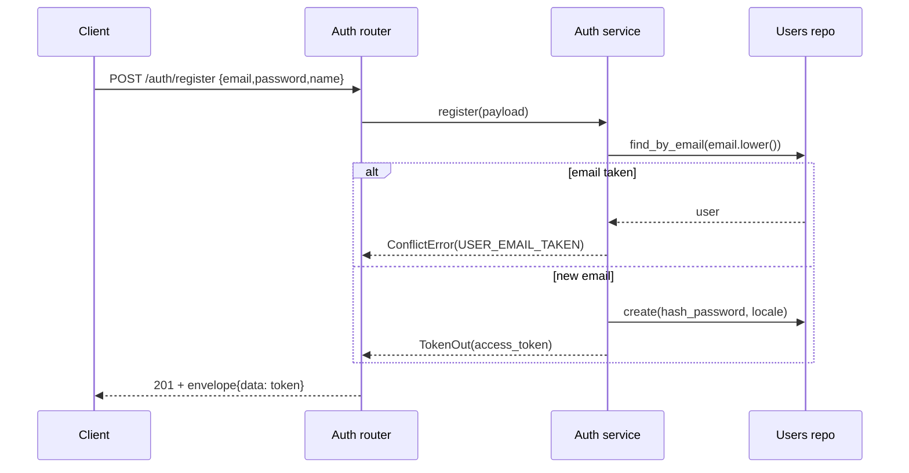

# 08 — Authentication

> Registration, login, token anatomy, and how to protect a route.

## What you will learn
- The register/login flow.
- What is inside an access token.
- How `CurrentUser` / `AdminUser` protect routes.
- The security decisions behind the design.

## Register / login flow


Login mirrors this but both an unknown email and a wrong password raise the **same**
`UnauthorizedError(Msg.AUTH_INVALID_CREDENTIALS)`, so the API never reveals whether an account
exists.

## Token anatomy
`create_access_token(subject)` signs a JWT (`HS256`) with:
- `sub` — the user id.
- `exp` — now + `access_token_ttl_minutes`.

`decode_access_token(token)` returns the `sub` or raises `UnauthorizedError(Msg.AUTH_TOKEN_INVALID)`.

## Protecting a route
Import the dependency from `app.features.auth.deps`:

```python
from app.features.auth.deps import CurrentUser, AdminUser


@router.get("/me")
async def read_me(user: CurrentUser) -> ApiResponse: ...


@router.get("")
async def list_users(_: AdminUser, params: PageParams = Depends()) -> ApiResponse: ...
```

- `CurrentUser` — requires a valid token for an active user.
- `AdminUser` — additionally requires `Role.ADMIN` (else `403 Forbidden`).

## Security decisions
- **Passwords**: argon2 via `pwdlib` (`PasswordHash.recommended()`).
- **No account enumeration**: identical error for unknown email and wrong password.
- **Inactive users** are rejected even with a valid token.
- **Tokens** are short-lived and signed with a secret from config (`JWT_SECRET`).

## Common mistakes
- Returning different errors for "no such user" vs "wrong password".
- Storing or exposing `password_hash` (never in `UserOut`).
- Putting auth logic in the router instead of `deps.py`/`service.py`.

## See also
- [07 — Database](07-database.md)
- [04 — Conventions](04-conventions.md)
- Feature README: [auth](../app/features/auth/README.md)