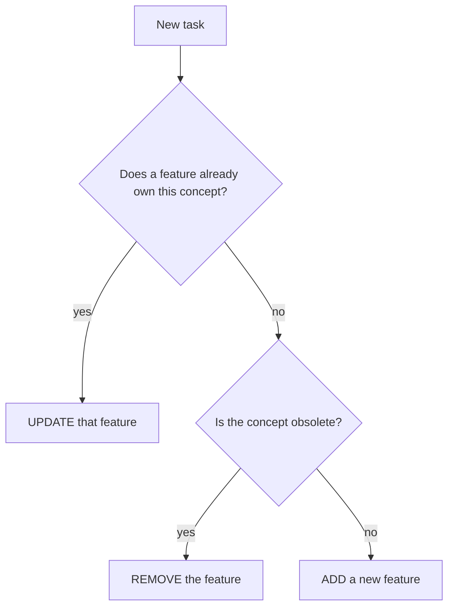

# 12 — Feature lifecycle

> The enforced ADD / UPDATE / REMOVE workflow: touch-maps, versioning, and done criteria.

## What you will learn
- The three actions and when to use each.
- The docs touch-map for every kind of change.
- The versioning rule.
- Definition of Done per action, the deprecation path, and common mistakes.

## 1. The three actions
- **ADD** — a new concept that no existing feature owns → a new folder under `app/features/`.
- **UPDATE** — any change to an existing feature (behavior, schema, breaking API, or refactor).
- **REMOVE** — a feature is obsolete → delete it, with or without dropping its data.

## 2. Docs touch-map
| Step | ADD | UPDATE: behavior | UPDATE: DB schema | UPDATE: breaking API | REMOVE |
|---|---|---|---|---|---|
| `app/features/<x>/README.md` | create (all sections) | edit Endpoints / Business rules, add Change history row | edit Data model, add row | edit, mark old behavior, add row | n/a (folder deleted) |
| `docs/features.md` | add row to Active | update "Last changed" (+ MCP/Prisma columns if changed) | update Prisma column | update "Last changed"; Status → `deprecated` if sunsetting | move row from Active to Removed |
| `docs/03-project-structure.md` | add feature to tree | only if files added/removed | no | no | remove feature from tree |
| `docs/CHANGELOG.md` | `Added` | `Changed` / `Fixed` | `Changed` (note migration name) | `Changed` with prefix **BREAKING:** | `Removed` |
| `docs/decisions/` ADR | only if a new convention is introduced | only if a new convention is introduced | if destructive migration | REQUIRED | REQUIRED if data is dropped |
| `docs/07-database.md` | only if a new pattern | no | only if a new pattern | no | no |
| `docs/glossary.md` | new domain terms | new domain terms | no | no | remove terms only this feature used |
| `core/messages.py` + every locale | add keys | add/edit keys | no | edit keys | remove keys no longer referenced |
| `core/constants.py` (`Tag`, `Limits`, enums) | add | edit | edit | edit | remove constants no longer referenced |
| `prisma/schema.prisma` + migration | add model | no | edit + `make migrate` | as needed | drop model + migration |
| `tests/` | add feature tests | add/adjust tests | adjust tests | adjust tests | delete the feature's tests |
| `pyproject.toml` version | minor bump | patch bump | minor bump | major bump (minor while `0.x`) | minor bump |
| `app/features/<x>/jobs.py` + `JobType` | add when the feature has slow work | add/adjust handler | n/a | n/a | delete with the folder; remove the `JobType` member |
| `AuditAction` + `audit.record` calls | one event per mutation | add events for new mutations | n/a | keep action names stable | remove unreferenced members (history stays in the DB) |
| `CacheNS` + `@cached` | add for hot reads | add invalidation for every new write path | review | review | remove with the feature |
| `Permission` / `RATE_POLICY` constants | add when a new capability/scope appears | edit | n/a | review | remove unreferenced |
| `transaction()` usage | wrap new mutations | adjust the transaction body | n/a | review | remove with the code |
| `If-Match` / `version` | add to new versioned resources | bump version rules | add column + migration | review | remove with the resource |

## 3. Versioning rule
Semantic Versioning. `pyproject.toml` is the **only** place the version is written;
`Settings.app_version` reads it. While the project is `0.x`, a breaking change bumps the minor.

## 4. Definition of Done per action
The full checklists live in the playbooks. In short:
- **ADD**: folder + README + registry row + tests + structure/CHANGELOG updates + version bump,
  then `make lint && make test && make feature-check`.
- **UPDATE**: the touch-map rows for your change type, a Change history row, "Last changed"
  updated, a CHANGELOG entry, version bump, tests, then the three `make` targets.
- **REMOVE**: nothing depends on it, deprecate first if released, decide data fate (ADR if
  dropping), `make remove-feature`, do the printed manual steps, CHANGELOG `Removed`, then the
  three `make` targets. Never delete history (CHANGELOG entries, ADRs).

## 5. Deprecation path
1. Set Status `deprecated` in the feature README **and** the registry.
2. Mark the affected routes `deprecated=True` and say so in their descriptions.
3. Add a CHANGELOG `Changed` entry.
4. Keep it for at least one minor version.
5. Then REMOVE following the remove playbook.

## 6. Common mistakes
- Editing code without updating the README.
- Deleting a model without a migration.
- Leaving orphan `Msg` keys or constants behind.
- Forgetting the registry row.
- Editing an old migration file instead of creating a new one.

## See also
- [Playbook: add a feature](playbooks/add-feature.md)
- [Playbook: update a feature](playbooks/update-feature.md)
- [Playbook: remove a feature](playbooks/remove-feature.md)
- [Playbook: add a background job](playbooks/add-background-job.md)
- [Playbook: cache a read](playbooks/add-cached-read.md)
- [Playbook: add an audit event](playbooks/add-audit-event.md)
- [Feature registry](features.md)
- [AGENTS.md](../AGENTS.md)