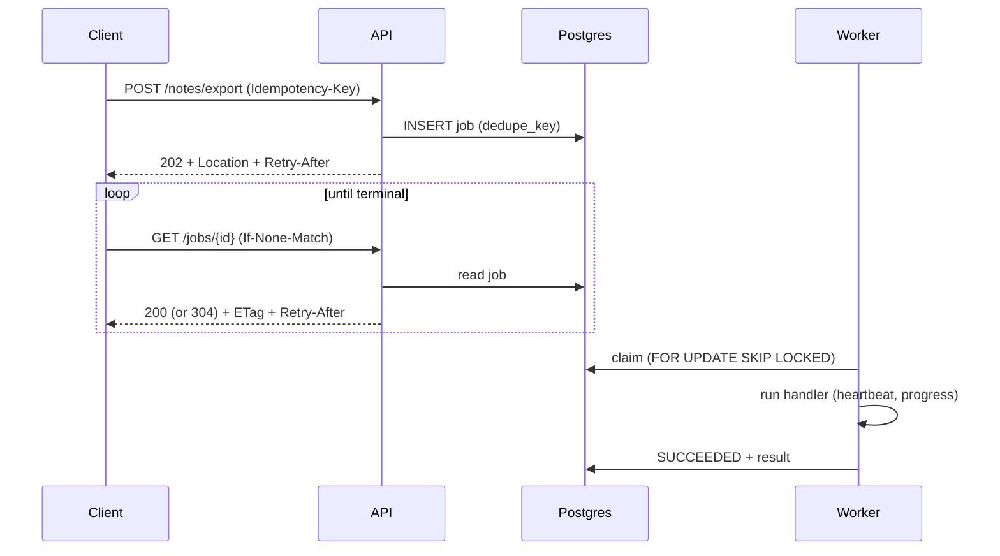
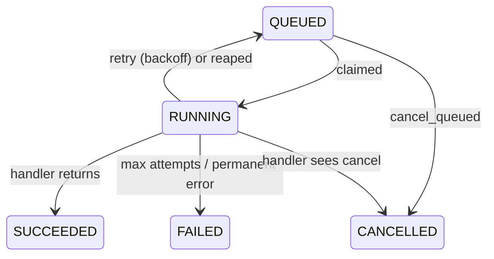

# 13 — Background jobs

> How slow work leaves the request, gets queued in Postgres, and runs on a worker you can scale.

## What you will learn
- When to use a job instead of doing work inline.
- The exact HTTP polling contract clients rely on.
- How the engine claims, runs, retries, reaps and schedules jobs.
- How to operate and scale the queue.

## When to use a job
Rule of thumb: if it takes **more than ~1 second**, calls an **external service**, or **fans out**
over many rows, it is a job — never inline in a request. The request returns immediately with
`202 Accepted` and a URL to poll.

## The HTTP polling contract
1. `POST /api/v1/notes/export` returns `202` with `Location: /api/v1/jobs/{id}` and
   `Retry-After: <seconds>`.
2. The client polls `GET /api/v1/jobs/{id}`. While the job is `QUEUED`/`RUNNING` the response
   carries `Retry-After`; send the last `ETag` back as `If-None-Match` and a `304` means nothing
   changed.
3. Terminal states are `SUCCEEDED`, `FAILED`, `CANCELLED` — stop polling and read `result`/`error`.
4. `POST /api/v1/jobs/{id}/cancel` cancels a `QUEUED` job, or requests cancellation of a `RUNNING`
   one (the handler observes it at the next `ctx.raise_if_cancelled()`).
5. Send an `Idempotency-Key` on the `POST`; repeating it returns the **same** job id.





## The engine
- **Claim**: one raw `UPDATE ... WHERE id IN (SELECT ... FOR UPDATE SKIP LOCKED)` so many workers
  never grab the same job.
- **Heartbeat**: a running job updates `heartbeat_at` every `JOB_HEARTBEAT_SECONDS`; the reaper
  requeues (or fails) jobs whose heartbeat is older than `JOB_STALE_SECONDS`.
- **Retries**: failures back off exponentially with jitter (`backoff_seconds`), up to
  `max_attempts`, then `FAILED`. `PermanentError` and bad payloads never retry.
- **Timeout**: each handler runs under `asyncio.timeout(handler.timeout)`.
- **At-least-once ⇒ idempotency**: a job may run more than once, so handlers MUST be idempotent.
- **Scheduler**: handlers with `schedule_every` are enqueued each bucket with a dedupe key
  `system:schedule:<type>:<bucket>`, so exactly one exists per bucket across all workers.
- **Result size**: results over `RESULT_MAX_BYTES` fail with `JOB_RESULT_TOO_LARGE`; put large
  outputs in object storage and return a URL.
- **Errors**: the client sees a translated `Msg` (`error` is a message key); details go to logs only.
- **Embedded vs standalone**: `WORKER_EMBEDDED=true` runs the worker in the API process (dev);
  in production run `make worker` (`python -m app.worker`) and scale horizontally.

## Operations
```sql
-- queue depth
SELECT status, count(*) FROM jobs GROUP BY status;
-- oldest queued job
SELECT min(run_at) FROM jobs WHERE status = 'QUEUED';
-- failed jobs by type
SELECT type, count(*) FROM jobs WHERE status = 'FAILED' GROUP BY type;
-- stuck RUNNING jobs (no heartbeat)
SELECT id, type, attempts FROM jobs
WHERE status = 'RUNNING' AND heartbeat_at < now() - interval '120 seconds';
```
The `JobStore` protocol is the escape hatch: swap the data layer (e.g. to another broker) without
touching the worker or features.

## Common mistakes
- Doing slow work inline and blocking the request.
- A handler that is not idempotent (double side effects on retry).
- Returning a huge result instead of a storage URL.
- Editing an old migration instead of adding a new one.

## See also
- [Playbook: add a background job](playbooks/add-background-job.md)
- [14 — Audit and activity logging](14-audit-and-activity-logging.md)
- [Feature registry](features.md)