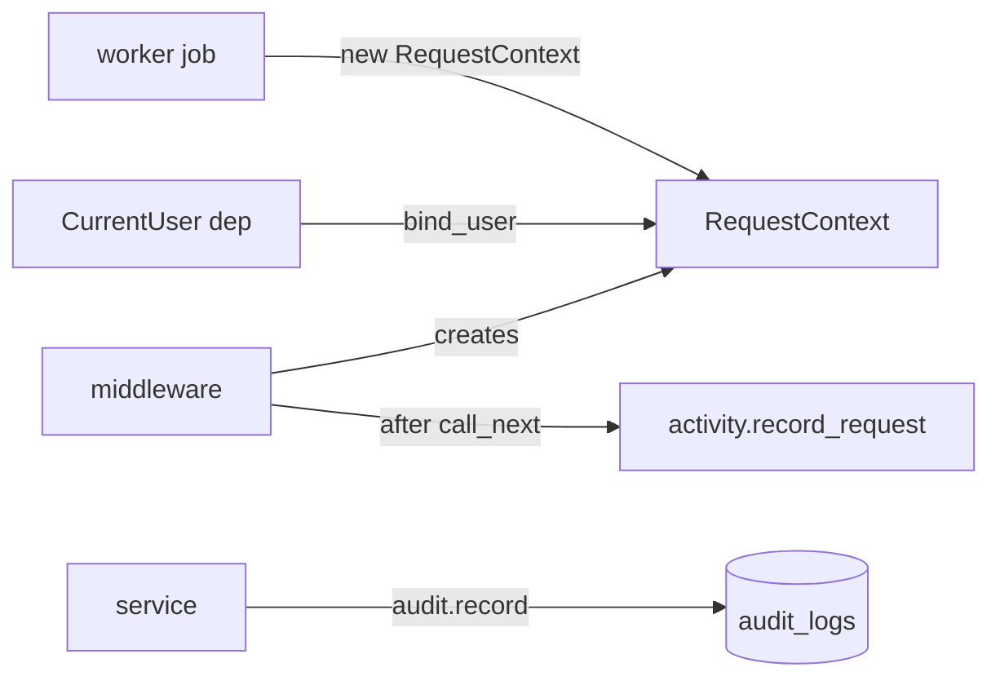

# 14 — Audit and activity logging

> Two logs with different jobs: a durable "who changed what" trail and a high-volume "every request" stream.

## What you will learn
- How audit and activity differ and why they are separate.
- How the request context flows and how worker jobs carry it.
- The diff/redaction format and append-only enforcement.
- Failure policy, retention, endpoints, and privacy.

## Audit vs activity
| Aspect | Audit (`audit_logs`) | Activity (`activity_logs`) |
|---|---|---|
| Purpose | Who changed what (compliance) | Every API request (ops/security) |
| Write path | `audit.record(...)` in services, synchronous | middleware → buffered, async, batched |
| Durability | Durable, append-only | Best-effort (drops on overload) |
| Volume | Low | High |
| Retention | `AUDIT_RETENTION_DAYS` (0 = forever) | `ACTIVITY_RETENTION_DAYS` |
| Who reads | Admin (`/audit`), self (`/audit/me`) | Admin (`/audit/activity`) |

Neither log has a foreign key to `users`, so history outlives user deletion.

## Request context flow
`RequestContext` is a mutable object in a ContextVar. A plain ContextVar set inside a dependency
would not be visible to middleware after `call_next`; the shared mutable object is.



## Recording an audit entry
```python
await audit.record(
    AuditAction.NOTE_UPDATE,
    AuditResource.NOTE,
    note_id,
    before=NoteOut.model_validate(before),
    after=NoteOut.model_validate(updated),
)
```
- `actor_id` defaults to the context user; system jobs record as `SYSTEM`.
- `changes` is a field-level diff `{field: {"from": x, "to": y}}` (create: before=None; delete:
  after=None); `updated_at` is ignored.
- `metadata` is redacted: keys in `Redaction.FIELDS` (`password`, `password_hash`, `token`,
  `access_token`, `secret`) become `***`.
- The worker puts `job_id` into metadata automatically.

## Append-only enforcement
Two layers: the repository is a `ReadRepository` (no `update`/`delete` by id, only `append` and
`purge_before`), and a DB trigger rejects `UPDATE` on `audit_logs` ("audit_logs is append-only").
`DELETE` is allowed only for the retention purge, which is itself audited.

## Failure policy
Default is **fail-open**: if the write fails, the full entry is logged as JSON at `ERROR`
(recoverable) and the request continues. Set `AUDIT_FAIL_CLOSED=true` to raise instead. A
transactional outbox is out of scope (see ADR 0006).

## Retention, endpoints, privacy
- The `maintenance` feature purges old activity/audit rows hourly and records each purge.
- Endpoints: `GET /audit` (admin), `GET /audit/me` (self), `GET /audit/activity` (admin).
- **Privacy**: entries store IP, user agent, and (on failed login) the attempted email — treat as
  PII. Activity stores route **templates** (e.g. `/api/v1/notes/{note_id}`), never raw ids.

## The coverage rule
`make feature-check` AST-scans every `app/features/*/service.py`: a public async function whose
name starts with `create/update/delete/register/login/cancel/request_` must contain
`audit.record(`, unless it carries a `# audit-exempt: <reason>` comment.

## Common mistakes
- A mutation that forgets `audit.record` (the check fails).
- Logging secrets (redaction only covers known field names).
- Storing raw URLs/ids in activity (use the route template).
- Assuming audit writes are transactional with the change (they are not, by design).

## See also
- [Playbook: add an audit event](playbooks/add-audit-event.md)
- [13 — Background jobs](13-background-jobs.md)
- [ADR 0006](decisions/0006-audit-and-activity-split.md)