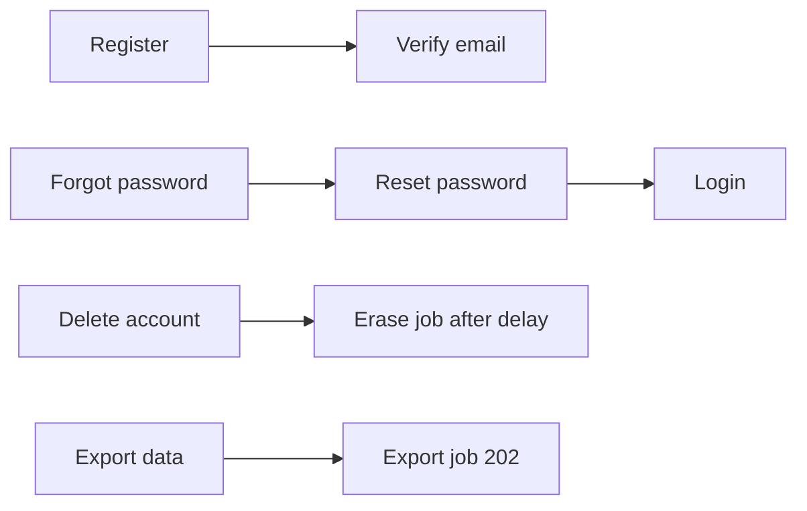

# 20 — Account lifecycle and privacy

> Verification, reset, deletion/export, PII inventory, and the audit scrub trigger.

## What you will learn
- The verify/reset/delete/export flows.
- The PII inventory and retention.
- How the audit trigger allows scrubbing `ip`/`user_agent` to NULL.

## Flows

- **Verify/reset** use single-use, hashed one-time tokens; the raw token only exists in the emailed
  link (created by the job, never stored in the jobs table).
- **Delete** (`DELETE /users/me`) anonymizes (email `deleted-<id>@invalid`, random password),
  deactivates, bumps `token_version`, revokes tokens, audits, and schedules `account.erase` after
  `ACCOUNT_ERASE_DELAY_DAYS`.
- **Export** (`POST /users/me/export`) returns 202; the job returns `{profile, notes, audit}`.

## PII inventory
| Field | Where | Why | Retention / erasure |
|---|---|---|---|
| email | users | identity | erased on account deletion |
| password_hash | users | auth (argon2) | overwritten on deletion |
| ip | audit/activity | security | scrubbed to NULL on erase; activity retention |
| user_agent | audit | security | scrubbed to NULL on erase |
| email_hash | audit metadata | correlation without PII | kept (pseudonymous) |

## Audit scrub trigger
`audit_logs_guard` blocks every UPDATE except setting `ip`/`user_agent` to NULL (used by the erase
job). DELETE is allowed only for retention.

## Common mistakes
- Storing the raw email in audit metadata (store `email_hash`).
- Deleting a user without scrubbing logs.
- Emailing a token that is also stored in the jobs table.

## See also
- [08 — Authentication](08-authentication.md)
- [14 — Audit and activity logging](14-audit-and-activity-logging.md)
- [ADR 0017](decisions/0017-pii-retention-and-audit-scrubbing.md)